<div align="center">

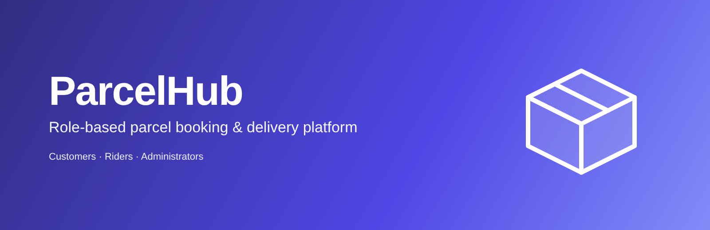

# ParcelHub

**A role-based parcel booking and delivery platform built with Spring Boot**
Customers book and pay for deliveries, verified riders pick them up, and administrators keep the network trustworthy


</div>

---

## Overview

Intra-city delivery is often slow to book, hard to follow and awkward to pay for ParcelHub models the whole
journey in one server-rendered web application with three separate portals:

| Portal | Audience | Entry point |
|--------|----------|-------------|
| **Customer** | People sending parcels | `/auth/register`, `/auth/login`, `/user/**` |
| **Rider** | Couriers who deliver them | `/rider/register`, `/rider/login`, `/rider/**` |
| **Admin** | Operators who verify riders | `/admin/login`, `/admin/**` |

Each portal has its own login page, remember-me cookie and Spring Security filter chain, so a session in one portal never grants access to another

## Features

| Role | What is available today |
|------|-------------------------|
| **Customer** | Register / sign in · book a parcel with pickup and receiver details · live price estimate · pay through an external payment gateway · see active bookings · booking history · edit profile |
| **Rider** | Register and complete onboarding (identity, licence and vehicle documents) · wait for verification · toggle availability · browse open parcels · accept one job at a time · move a parcel through pickup, transit and delivery · earnings credited on delivery |
| **Admin** | Review pending riders and their uploaded documents · approve or reject · manage own profile |
| **Platform** | Strict parcel status state machine · 6-digit tracking codes · Flyway-managed schema · validated file uploads (jpg / png / pdf, max 5 MB) · tracing, metrics and log shipping hooks |

## UI previews

<table>
<tr>
<td width="50%">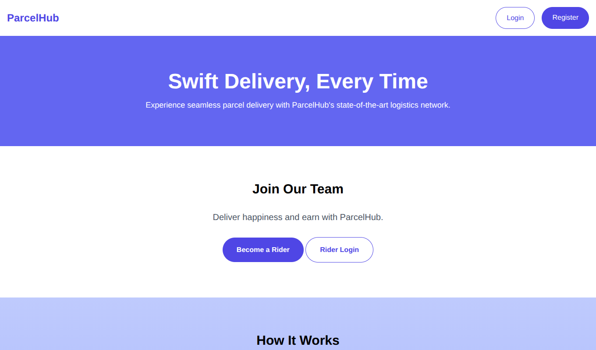<br><sub><b>Landing page</b> – entry for customers and riders</sub></td>
<td width="50%">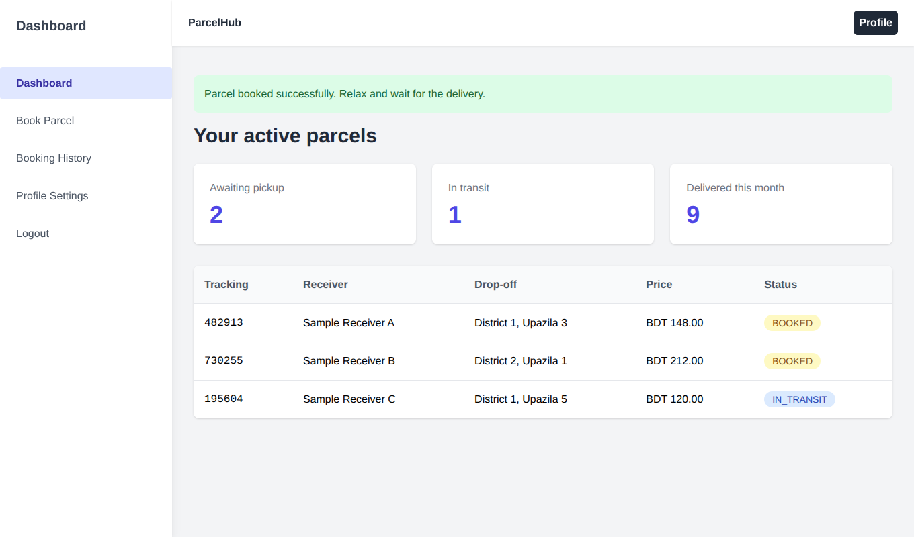<br><sub><b>Customer dashboard</b> – active parcels and status</sub></td>
</tr>
<tr>
<td>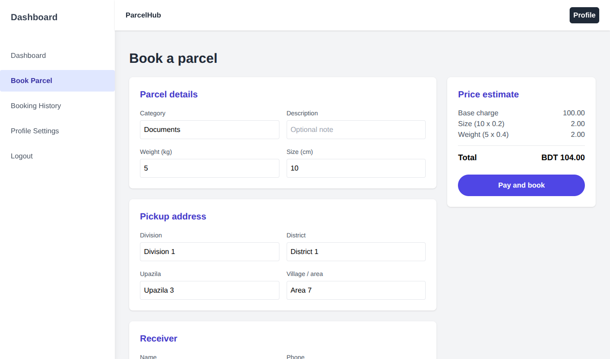<br><sub><b>Book a parcel</b> – details, addresses and live price</sub></td>
<td>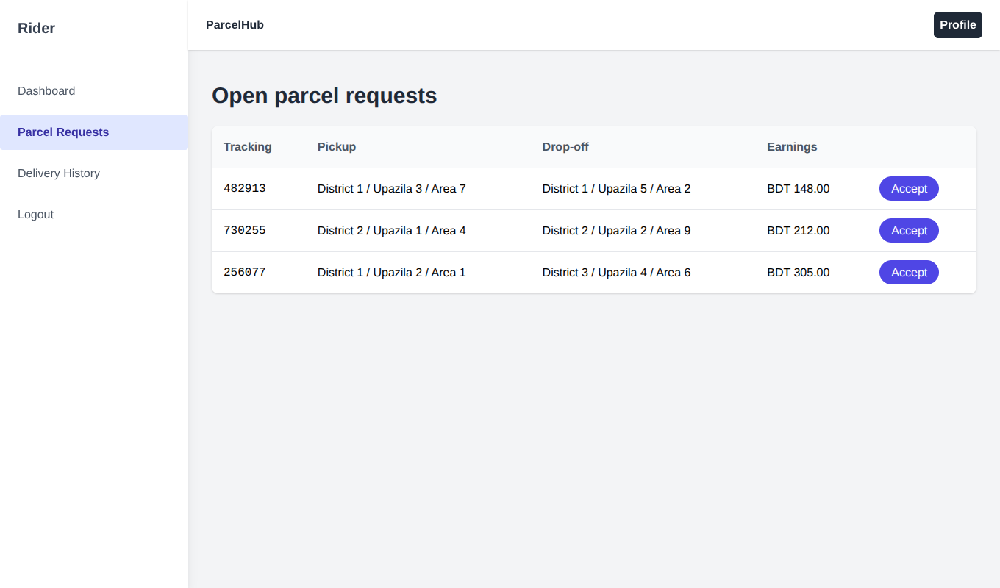<br><sub><b>Rider job board</b> – open requests to accept</sub></td>
</tr>
<tr>
<td>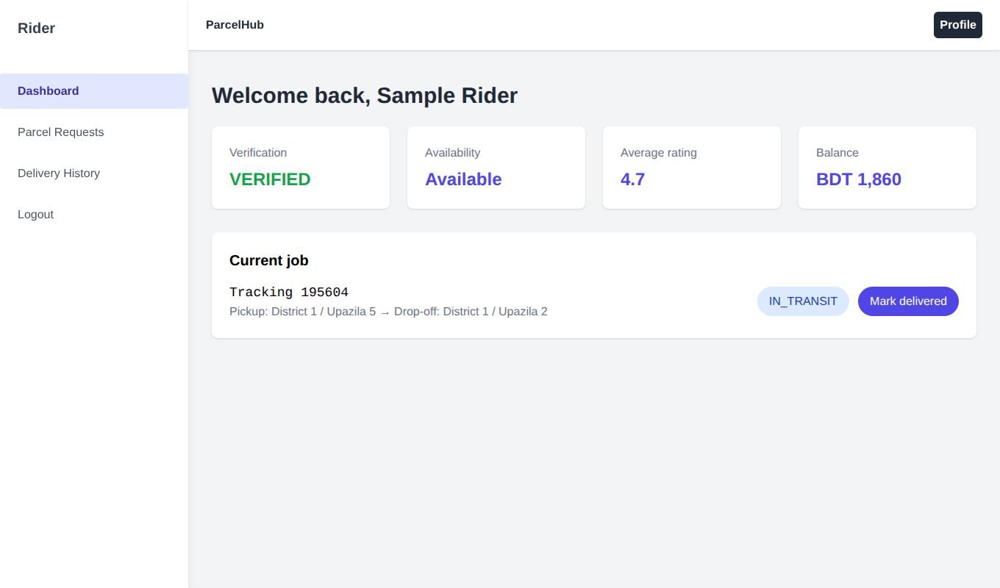<br><sub><b>Rider dashboard</b> – verification, rating, balance, current job</sub></td>
<td>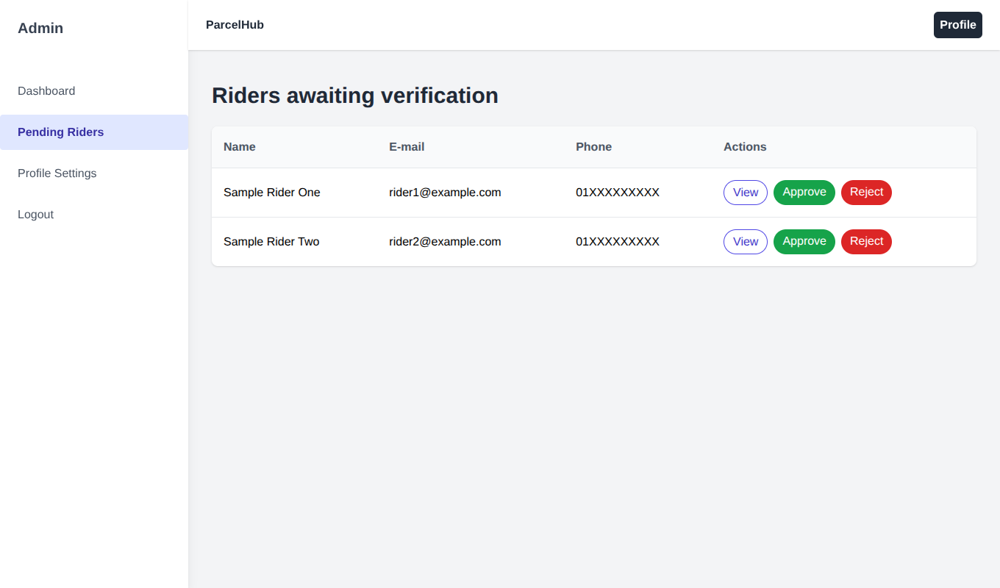<br><sub><b>Admin approvals</b> – verify or reject new riders</sub></td>
</tr>
</table>

## How it works

### 1. Booking and payment

<p align="center">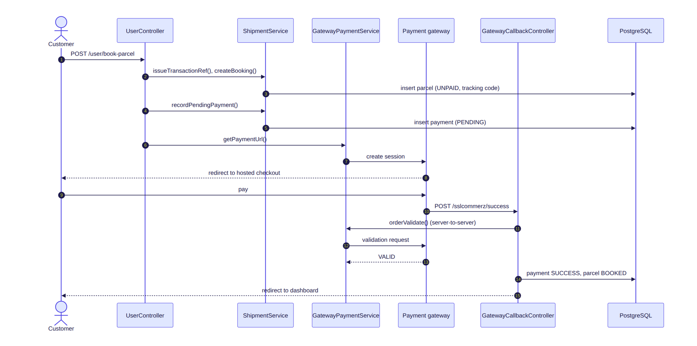</p>

A booking is stored as `UNPAID` together with a `PENDING` payment. The parcel only becomes `BOOKED` (and visible to riders) after the gateway callback has been validated server-to-server. Cancelling at the gateway removes the booking and its payment

### 2. Rider onboarding and delivery

<p align="center">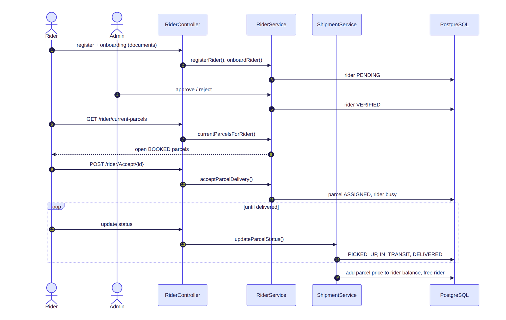</p>

### 3. Parcel status lifecycle

<p align="center">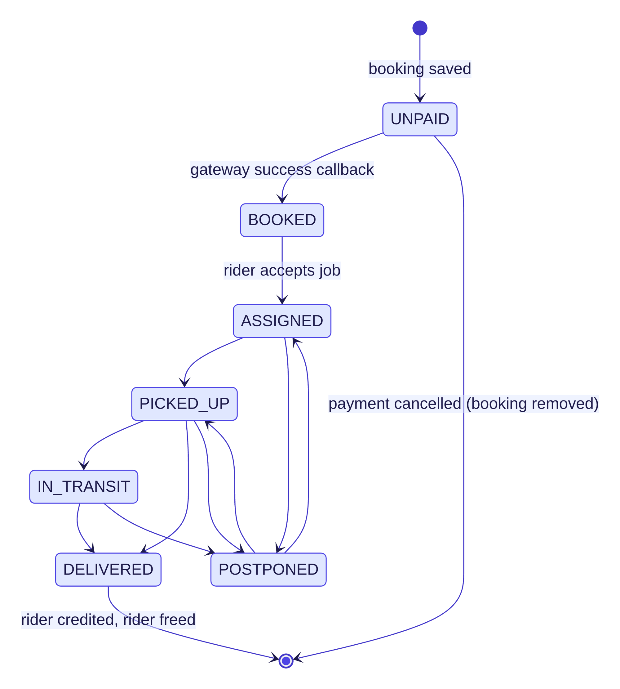</p>

Transitions are enforced in `ShipmentService`; anything outside this diagram raises an `IllegalStateException`
Delivering a parcel adds its price to the rider's balance and frees the rider for the next job

## Architecture

<p align="center">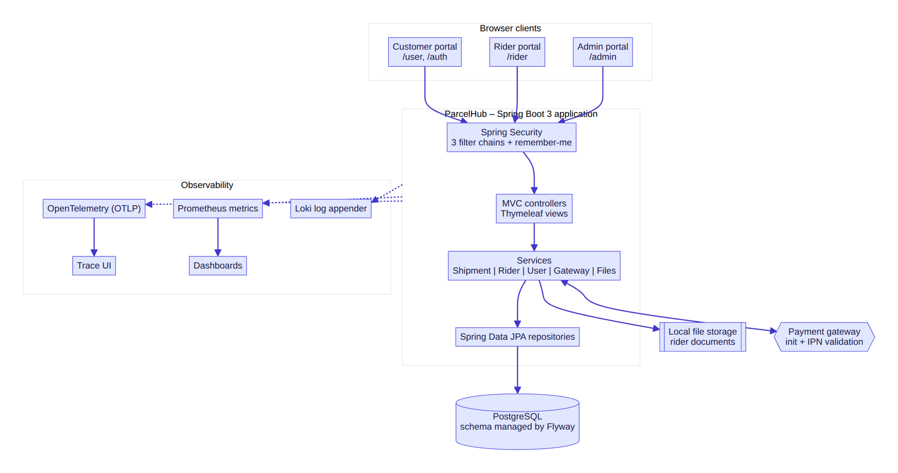</p>

The application is a layered monolith:

- **Security** – three `SecurityFilterChain` beans (admin, customer, rider) built from one shared helper
- **Controllers** – MVC controllers returning Thymeleaf views; a small REST endpoint serves price quotes
- **Services** – business rules: `ShipmentService`, `RiderService`, `UserService`, `GatewayPaymentService`, `ParcelCategoryService`, `FileStorageService`, `HashVerificationService`
- **Persistence** – Spring Data JPA repositories on PostgreSQL, schema versioned with Flyway

<p align="center">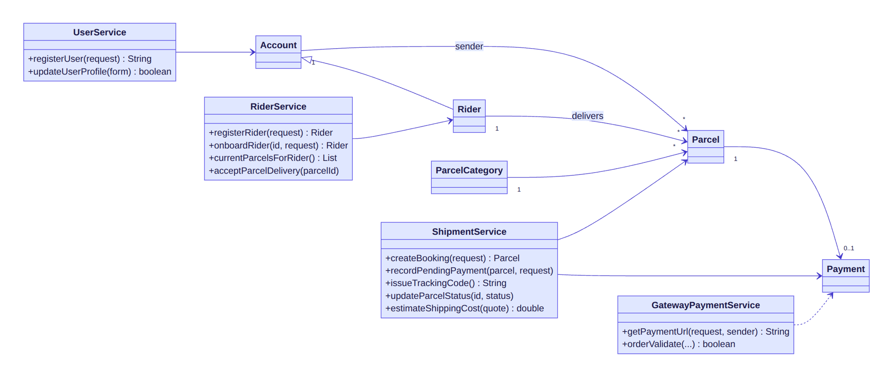</p>

## Data model

<p align="center">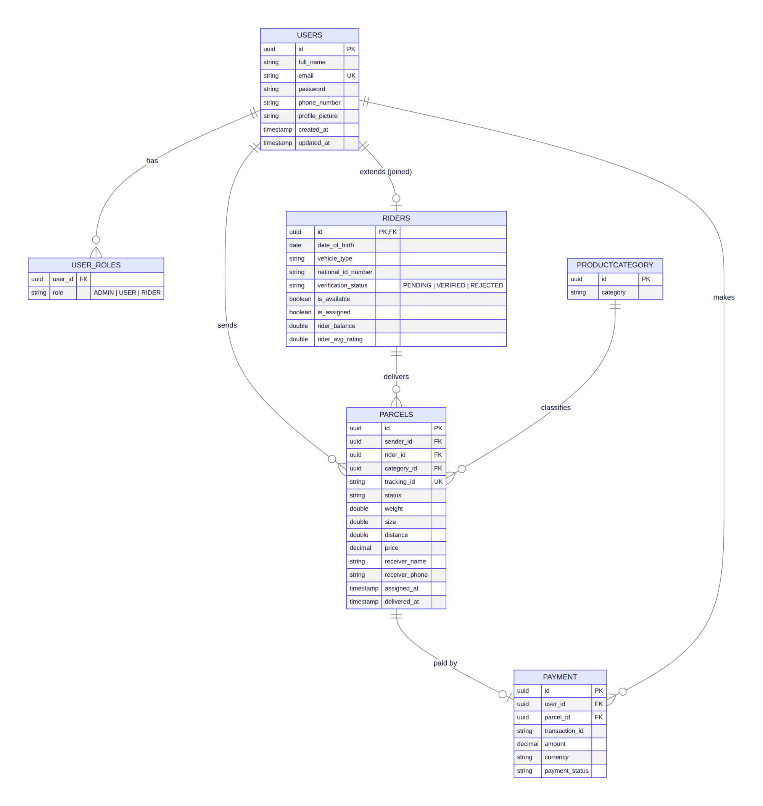</p>

`riders` extends `users` through joined-table inheritance, so every rider is also an account with roles

## Tech stack

| Concern | Technology |
|---------|------------|
| Language / runtime | Java 17 |
| Framework | Spring Boot 3.4 (Web, Security, Data JPA, Validation, Actuator) |
| Views | Thymeleaf + layout dialect, Tailwind CSS, jQuery DataTables |
| Database | PostgreSQL, Hibernate, Flyway migrations |
| Mapping | MapStruct, ModelMapper, Lombok |
| Observability | Micrometer → OpenTelemetry (OTLP), Prometheus registry, Loki logback appender |
| Testing | JUnit 5, Mockito, H2, JaCoCo |
| Code quality | Spotless (Palantir Java Format), SonarQube-ready |
| Packaging | Gradle wrapper, multi-stage Dockerfile, Docker Compose for local services |

## Project structure

```text
.
├── build.gradle · settings.gradle · Dockerfile · docker-compose.yml
├── docs/
│   ├── visuals/
│   │   ├── branding/        banner
│   │   ├── ui-previews/     interface previews (sample data)
│   │   ├── flows/           booking, rider and status-machine charts
│   │   └── structure/       system overview, data model, domain layers
│   └── sources/
│       ├── mermaid/         text sources for the charts
│       └── drawio/          editable draw.io files
└── src/
    ├── main/java/com/parcelhub/logistics/
    │   ├── ParcelHubApplication.java
    │   ├── config/          RestTemplate, ModelMapper, OTLP exporter
    │   ├── controller/      Public, Auth, User, Rider, Admin, Files, ShippingQuote, GatewayCallback
    │   ├── dto/
    │   │   ├── request/     AccountRegistrationRequest, ParcelBookingRequest, RiderOnboardingRequest, …
    │   │   ├── response/    RiderDashboardView, OpenParcelView, RiderProfileView, …
    │   │   └── paymentapiresponse/
    │   ├── entity/          Account, Rider, Parcel, ParcelCategory, Payment
    │   ├── enums/           Role, ParcelStatus, PaymentStatus, VerificationStatus, …
    │   ├── exception/
    │   ├── mapper/          MapStruct mappers
    │   ├── repository/
    │   ├── security/        SecurityConfig, AccountDetailsService
    │   ├── service/
    │   └── util/            SessionUtil, ProfileFormUtil, GatewayHttpUtil
    ├── main/resources/      templates/, static/, application*.properties, db/migration/
    └── test/                unit tests mirroring the main packages
```

## Getting started

### Prerequisites

| Tool | Version |
|------|---------|
| JDK | 17 or newer |
| Docker + Docker Compose | any recent version (for PostgreSQL) |
| Git | any |

### Run locally

```bash
# 1. Get the code
git clone https://github.com/walidwh21/ParcelHub_Delivery-System.git parcelhub
cd parcelhub

# 2. Start PostgreSQL (and Adminer on http://localhost:9080)
docker compose up -d

# 3. Start the app with the development profile
SPRING_PROFILES_ACTIVE=dev ./gradlew bootRun
```

The application listens on <http://localhost:8080>

### Create the administrator account

The first migration seeds one administrator whose e-mail and password hash come from the environment
Until `ADMIN_PASSWORD_HASH` is provided the account exists but **cannot sign in**

```bash
# generate a bcrypt hash (any bcrypt tool works), then prefix it with {bcrypt}
HASH=$(htpasswd -bnBC 10 "" 'choose-a-strong-password' | tr -d ':\n' | sed 's/^\$2y/$2a/')
export ADMIN_EMAIL=admin@your-domain.example
export ADMIN_PASSWORD_HASH="{bcrypt}${HASH}"
```

Set these **before the first start** against an empty database (Flyway applies the seed once)

### Run with Docker

```bash
docker build -t parcelhub .
docker run --rm -p 8080:8080 \
  -e DB_URL=jdbc:postgresql://host.docker.internal:5432/parcelhub \
  -e DB_USERNAME=postgres -e DB_PASSWORD=postgres \
  -e REMEMBER_ME_KEY="$(openssl rand -hex 32)" \
  parcelhub
```

## Configuration reference

Everything environment specific is read from environment variables.

| Variable | Purpose | Default |
|----------|---------|---------|
| `DB_URL` | JDBC URL | `jdbc:postgresql://localhost:5432/parcelhub` |
| `DB_USERNAME` / `DB_PASSWORD` | Database credentials | `postgres` / `postgres` (local only) |
| `REMEMBER_ME_KEY` | Secret for remember-me cookies – **required** outside the `dev` profile | – |
| `UPLOAD_PATH` | Directory for rider documents | `uploads` |
| `GATEWAY_STORE_ID` / `GATEWAY_STORE_PASSWORD` | Payment-gateway merchant credentials | empty |
| `GATEWAY_INIT_URL` / `GATEWAY_VALIDATION_URL` | Gateway session and validation endpoints | sandbox URLs |
| `GATEWAY_CALLBACK_BASE_URL` | Public base URL the gateway calls back | `http://localhost:8080` |
| `ADMIN_EMAIL` / `ADMIN_PASSWORD_HASH` | Seeded administrator (see above) | `admin@example.com` / non-matching hash |
| `APPLICATION_BASE_URL` | Public URL of this app | `http://localhost:8080` |
| `TRACING_URL` | OTLP HTTP trace endpoint | `http://localhost:4318/v1/traces` |
| `LOKI_URL` | Loki push endpoint | `http://localhost:3100/loki/api/v1/push` |

## Pricing model

```
price = base-charge + per-size-unit × size + per-weight-unit × weight
```

The three factors are plain properties (`parcelhub.pricing.base-charge`, `…per-size-unit`, `…per-weight-unit`)
with defaults of `100`, `0.2` and `0.4` (BDT), so rates can change per deployment without touching code
The same calculation backs the live estimate in the booking form via `POST /parcel/shipping-cost`

## Testing & quality

```bash
./gradlew test           # unit tests, H2 in-memory – no external services needed
./gradlew build          # compile, test and produce the JaCoCo report (build/reports/jacoco)
./gradlew spotlessApply  # format the code
./gradlew sonar          # optional; needs SONAR_HOST_URL, SONARCLOUD_TOKEN, SONAR_PROJECT_KEY
```
